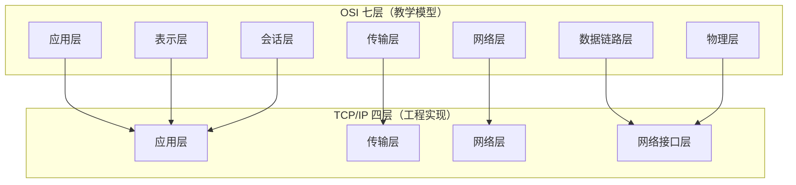

# 分层模型与协议栈

## 一句话结论

分层不是为了"分类好看"，而是为了**把变化隔离开**：只要接口不变，改一层的实现不必动另一层。
这一节的全部内容，都是围绕这句话展开的。

## 为什么必须分层

设想不分层：你要写一个视频通话功能，得同时操心"网线有没有插好""对方的 IP 是多少""丢包了怎么补""音频编码用什么格式"。
这些问题分属完全不同的量级——有的每秒变化上千次，有的整个会话只决定一次。混在一起写，改一个必崩另一个。

分层的收益很具体：

1. **故障定位**：连不上，先 ping（网络层），再 telnet 端口（传输层），最后看 HTTP 状态码。逐层排除，而不是瞎猜。
2. **复用**：HTTP、SMTP、DNS 都跑在 TCP/UDP 上，不用各写一套可靠传输。
3. **替换**：链路层从以太网换成 Wi-Fi，你的 HTTP 代码一行都不用改。

代价也有：每层都要加自己的头部，还要互相传参。所以真实协议栈的层数不会多，**七层已经是教学上限**。

## OSI 七层与 TCP/IP 四层

对应关系要记住的是**为什么合并**：

- 表示层（编码、压缩、加密）和会话层（连接管理）几乎没有独立实现，都被并进了应用层协议里。比如 TLS 是"表示层"的事，但人人把它当应用层的一部分。
- 物理层和数据链路层在网卡驱动里一起实现，合称网络接口层。

所以考试写七层，写代码认四层，两套说法并不矛盾。

## 数据单元与头部

| 层 | 数据单元 | 关键头部字段 |
| --- | --- | --- |
| 应用层 | 报文 message | 取决于协议（HTTP 的方法是请求行，DNS 是查询名） |
| 传输层 | 段 segment / 数据报 datagram | 源端口、目的端口、序号、校验和 |
| 网络层 | 分组 packet | 源 IP、目的 IP、TTL、协议号 |
| 链路层 | 帧 frame | 源 MAC、目的 MAC、类型、FCS |

每下一层，就在前面贴一个自己的头部，这叫**封装**；到对端往上走时再一层层撕掉，叫**解封装**。

## 一次请求的完整旅行

以"浏览器访问 `example.com`"为例，只看**一个 HTTP 请求**在协议栈里的轨迹：

1. **应用层**：浏览器生成 `GET / HTTP/1.1` 报文，目标主机名 `example.com`。
2. **DNS 解析**：应用层先查缓存，没命中就向 DNS 服务器发 UDP 查询，拿到 IP。
3. **传输层**：TCP 三次握手建立连接，分配源端口（比如 51234）和目的端口 80，给报文加上序号。
4. **网络层**：查路由表决定下一跳，加上源 IP、目的 IP，TTL 设成 64。
5. **链路层**：ARP 查出下一跳的 MAC，封装成帧，交给网卡。
6. **物理层**：变成电信号/光信号发出去。

对端收到的顺序完全相反：网卡拆帧 → IP 层检查目的地址是不是自己 → TCP 层按序号重组、回 ACK → 应用层交给 Web 服务器。

> [!warning] 常见误解
> "IP 地址是给主机用的"这句话不完整。IP 标识的是**网络接口**，一台路由器每个接口一个 IP，所以"主机的 IP"其实特指某个网卡。

## 三个必须能答上来的问题

1. **为什么端到端可靠性放在传输层，而不是每一跳都保证？**
   每一跳都做重传，会让中间节点的状态和开销爆炸；端到端做，"网络尽力而为、端系统负责可靠"，把复杂度推到了边缘，这正是互联网能扩展的原因。
2. **MTU 和 MSS 是什么关系？**
   MTU 是链路层一帧能承载的最大数据量（以太网 1500 字节），MSS 是 TCP 段里数据的最大长度，通常等于 MTU 减去 IP 头和 TCP 头（1500−20−20=1460）。
3. **分层的边界为什么在"端口"这里？**
   端口是传输层交给应用层的多路复用点。有了端口，一台主机上的多个进程才能共用同一个 IP。

## 下一步

把这一层的"地图"记住后，往下就是逐个填格子：[分层模型速记](02-分层模型速记.md) 里有一张可以考前五分钟过一遍的表。
